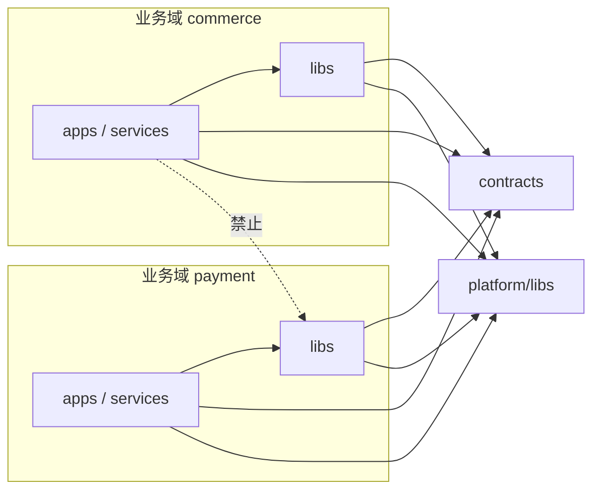

# 多业务多技术栈 Monorepo 架构设计

> 状态：草案 v0.3；日期：2026-11-09（修订记录见文末）
> 适用于多条业务线、多种语言共用一个代码仓库的研发组织。文中的工具版本和弃用信息以 2026-11 为准，来源列在文末。

## 摘要

- 目录按业务域划分：`domains/<域>/{apps,services,libs}`。跨业务共享的代码放在 `platform/`，跨服务接口放在 `contracts/`。
- 每种语言一个根级工作区、一份锁文件，同一个第三方依赖在全仓库只有一个版本。
- 业务域之间只能通过接口契约（protobuf / OpenAPI 生成的客户端）或平台库交互，这条规则由 CI 检查。
- 构建编排选 Nx。各项目的构建和测试仍使用原生命令（`go test`、`gradle build`、`pnpm build`、`uv run pytest`）。
- 代码放在 GitHub 公开仓库，CI 使用 GitHub Actions 免费的托管 runner。PR 只跑受影响的项目，构建缓存先用 GitHub Actions 缓存，只有 `main` 的构建写入。
- 可部署单元各自独立发布，部署状态放在单独的 GitOps 仓库；内部库不发版本。

## 1. 目标与非目标

**目标**

1. 各业务线的应用、服务、共享库和接口定义放在同一个仓库。跨项目的改动可以在一次提交里完成，并一起评审。
2. 每种语言使用自己的原生工具，开发体验接近单项目仓库。
3. 每个 PR 只构建和测试受影响的项目，并复用主干构建留下的缓存。
4. 业务之间的依赖方向由工具检查，同一仓库里的代码也不能随意互相引用。
5. 每个可部署单元独立发布，全仓库没有统一的发布节奏。

**非目标**

- 第一阶段不做 Bazel 式的密闭构建和远程执行，升级条件见第 10 节。
- 暂不纳入原生移动端（iOS / Android），后续扩展时再评估（见第 10 节）。
- 不做代码读权限隔离。仓库是公开的，任何人都能读全部代码和提交历史（见 7.4、7.5）。

## 2. 前提假设

以下假设不成立时，相应章节需要调整：

- 规模：50～300 名工程师，3～10 条业务线，200～2000 个项目。“项目”指一个应用、服务或库。
- 技术栈：暂按 TypeScript（Web 前端、BFF、Node 服务）、Go（后端服务）、Java / Kotlin（交易等核心系统）、Python（数据与算法服务）设计。实际技术栈和各语言的项目数量还在确认中；已决定无论结果如何都保持 Nx（见 5.1），确认后只需调整 4.3 中各语言工作区的细节。其他语言按 4.7 的准入条件接入。
- 代码托管在 GitHub 的公开仓库，仓库归属一个 GitHub 组织（免费的 GitHub Free for organizations 即可），不购买付费计划。合并队列和 CODEOWNERS 里的团队都要求仓库归属组织。
- CI 使用 GitHub Actions 免费版（见 6.5）。GitHub 的免费功能都可以使用，除此之外暂不引入第三方 SaaS。
- 服务运行在 Kubernetes 上，前端静态资源发布到 CDN。

## 3. 设计原则

1. **目录按业务域划分，语言只是项目的属性。** 目录结构对应团队和所有权，与语言无关。
2. **每种语言一个根级工作区、一份锁文件。** 同一个第三方依赖在仓库内只有一个版本（单一版本策略）。
3. **跨业务只通过接口契约交互。** 业务 A 不能引用业务 B 的代码，只能依赖 B 提供的契约，或者依赖下沉到平台层的通用库。
4. **规则由工具检查。** 依赖方向、所有权、契约兼容性都在 CI 里检查，不依赖口头约定。
5. **任务用原生命令，编排层尽量薄。** 编排工具只声明任务的输入、输出和依赖关系，这样将来更换编排工具时，各项目自己的构建配置不用改。
6. **平台团队维护标准模板。** 新建服务、接入新语言都通过生成器和模板完成，不靠复制旧项目。

## 4. 仓库结构

### 4.1 顶层目录

```text
.
├── domains/                    # 业务域，每条业务线一个目录
│   ├── commerce/
│   │   ├── apps/               # 前端与客户端应用（可部署）
│   │   │   └── shop-web/       # TypeScript
│   │   ├── services/           # 后端服务（可部署）
│   │   │   ├── order-svc/      # Go
│   │   │   └── pricing-svc/    # Kotlin
│   │   ├── libs/               # 域内共享库，只允许本域依赖
│   │   │   └── cart-model/
│   │   ├── e2e/                # 本域的端到端测试
│   │   └── README.md           # 负责团队、值班方式、服务清单
│   ├── payment/
│   └── content/
├── platform/                   # 跨业务共享，平台团队维护
│   ├── libs/                   # 日志、链路追踪、配置、RPC 客户端、鉴权 SDK、UI 组件库
│   └── services/               # 网关、鉴权中心等平台服务
├── contracts/                  # 跨服务接口：protobuf、OpenAPI、事件定义及生成代码
│   ├── buf.yaml
│   ├── commerce/
│   └── payment/
├── e2e/                        # 跨业务域的端到端测试
├── tools/                      # 生成器、Nx 本地插件、检查脚本、CI 辅助脚本
├── infra/                      # 基础镜像、Helm 基础 chart、Terraform 模块
├── docs/                       # 架构文档与 ADR
├── .github/                    # CODEOWNERS 与 Actions 工作流
├── nx.json                     # 编排层配置
├── mise.toml                   # 工具链版本：Node、pnpm、Go、JDK、Python、uv、buf
├── package.json  pnpm-workspace.yaml  pnpm-lock.yaml   # TypeScript 工作区
├── go.mod  go.sum                                       # Go 单模块
├── settings.gradle.kts  gradle/libs.versions.toml       # JVM 工作区
└── pyproject.toml  uv.lock                              # Python 工作区
```

### 4.2 项目与命名

- 一个项目对应一个目录。目录里放该语言的清单文件（`package.json`、`build.gradle.kts`、`pyproject.toml`）和 Nx 的 `project.json`。Go 项目没有单独的清单文件，原因见 4.3。
- 业务项目的路径固定为 `domains/<域>/<类型>/<项目>`，平台项目为 `platform/<类型>/<项目>`，项目内部不再嵌套项目。路径层级固定后，CODEOWNERS、工作区通配符和 CI 规则都可以用固定模式匹配。
- 项目名全局唯一，格式为 `<域>-<目录名>`，例如 `commerce-order-svc`。各语言工具里使用同一个名字：Gradle 项目名、npm 包名（`@mono/commerce-shop-web`）、uv 成员名。
- 平台库的同一能力有多种语言实现时，用语言后缀区分，例如 `platform/libs/tracing-go`、`platform/libs/tracing-ts`、`platform/libs/tracing-jvm`。

### 4.3 各语言的工作区

| 语言 | 工作区 | 锁文件 | 单一版本的实现方式 |
| --- | --- | --- | --- |
| TypeScript | 根 `pnpm-workspace.yaml` | `pnpm-lock.yaml` | pnpm catalog，设置 `catalogMode: strict` |
| Go | 根目录单个 `go.mod` | `go.sum` | 单模块本身只有一套依赖版本 |
| Java / Kotlin | 根 `settings.gradle.kts` 包含所有 JVM 项目 | Gradle 依赖锁定文件 | 版本目录 `gradle/libs.versions.toml` |
| Python | 根 `pyproject.toml` 的 `[tool.uv.workspace]` | `uv.lock` | uv 工作区只解析一套依赖 |

**TypeScript。** pnpm 默认的严格 `node_modules` 布局能阻止幽灵依赖（使用未声明的包）。内部包之间用 `workspace:*` 引用，第三方依赖统一写成 `catalog:`。`pnpm-workspace.yaml` 用 `domains/*/apps/*`、`platform/libs/*` 这类通配符，pnpm 只把含 `package.json` 的目录当作包，其他语言的目录不受影响。

**Go。** 全仓库只有一个模块（例如 `module example.com/mono`），所有 Go 项目都是这个模块下的包。

- 选单模块有三个原因：依赖版本天然统一；不需要提交 `go.work`（Go 官方文档认为一般不宜把 `go.work` 提交到版本库）；Docker 构建只需要根目录的 `go.mod`、`go.sum` 加源码。
- 用 Go 1.25 引入的 `ignore` 指令排除非 Go 目录。例如 `ignore node_modules` 不带 `./` 前缀，会忽略任意层级的同名目录。
- 服务的私有代码放在 `<服务>/internal/` 下，编译器会阻止其他服务引用。
- 代价：nx-go 插件的推断任务只支持多模块工作区，所以 Go 项目的任务要写在 `project.json` 里，项目间的依赖关系由一个 Nx 本地插件生成（见 5.2）。

**Java / Kotlin。** 全仓库一个根 Gradle 构建，`@nx/gradle` 从中推断项目、任务和依赖。已经使用 Maven 的团队可以保留 Maven 多模块结构，改用 `@nx/maven`。JDK 版本由 `mise.toml` 固定，编译目标版本用 Gradle toolchain 声明。`settings.gradle.kts` 的 include 列表由生成器维护。

**Python。** 使用 uv 工作区，全仓库一份 `uv.lock`。有三点要注意：

- uv 要求 `members` 匹配到的每个目录都有 `pyproject.toml`，所以 `members` 写显式路径列表，由生成器在新建项目时追加。不要用会匹配到其他语言目录的通配符。
- uv 工作区的所有成员共用一个 `requires-python`（取各成员声明的交集）。需要其他 Python 版本的项目不放进工作区，单独建虚拟环境。
- Python 没有依赖隔离，一个成员可以导入另一个成员声明的包，uv 无法阻止。用 deptry 检查未声明的依赖。

**其他语言。** Rust 用根 Cargo 工作区，其他语言按同样的思路处理，接入条件见 4.7。

### 4.4 接口契约（contracts/）

- 服务之间的同步调用用 protobuf 定义，走 gRPC 或 Connect；面向浏览器和外部的 HTTP 接口用 OpenAPI 3.1。每个接口只有一份定义。
- 消息队列里的事件同样用 protobuf 定义，放在 `contracts/<域>/events/`。
- 每个契约包（例如 `contracts/commerce/order/`）是一个独立项目，归接口提供方所有。
- `buf generate` 把各语言的生成代码写到契约包下的 `gen/<语言>/`。每个生成目录都是对应语言工作区里的一个项目：npm 包、Gradle 项目、uv 成员，Go 则是根模块里的一个包。消费方只依赖自己语言的那一份，所以改一个契约只会影响它的消费者。
- 生成代码提交到仓库。这样拉下代码后 IDE 直接可用，评审时也能看到接口变化在各语言里的效果。CI 会重新生成一遍并执行 `git diff --exit-code`，发现手工修改或漏生成就失败。在 `.gitattributes` 中给 `contracts/**/gen/**` 加上 `linguist-generated`，GitHub 的 PR 界面会默认折叠这些文件。
- 兼容性检查：protobuf 用 `buf breaking` 与主干对比，OpenAPI 用 oasdiff。破坏性变更必须新建版本目录（如 `v2`），旧版本保留到所有消费方迁移完成。

### 4.5 依赖规则

每个项目在 `project.json` 里声明三类标签：

- `domain:<域名>`，平台项目为 `domain:platform`
- `type:app`、`type:service`、`type:lib`、`type:contract`、`type:e2e`、`type:tool` 之一
- `lang:ts`、`lang:go`、`lang:jvm`、`lang:py` 之一，用于 CI 分组和统计，不参与依赖规则

| 项目 | 允许依赖 |
| --- | --- |
| 应用、服务（`type:app`、`type:service`） | 同域的 lib、平台 lib、任意 contract |
| 业务域的 lib | 同域的 lib、平台 lib、任意 contract |
| 平台 lib | 平台 lib、平台 contract |
| contract | contract（仅用于引用公共类型） |
| e2e | 任意应用、服务、contract、平台 lib |
| tool | 任意项目；生产代码不能依赖 tool |



补充规则：

- 应用和服务不能被任何项目依赖（e2e 除外）。
- 一个域想复用另一个域的东西时：通用能力下沉到 `platform/`；业务逻辑通过调用对方服务的契约获得，不以库的形式共享。
- 数据同样有边界。每个服务独占自己的数据库 schema，迁移脚本放在服务目录里，其他服务不能直连这个库。

规则分三层检查：

1. **项目图检查，覆盖所有语言。** CI 执行 `nx graph --file=graph.json` 导出项目图，再由 `tools/` 里的脚本按上表逐条校验依赖边。Nx Enterprise 的 `@nx/conformance` 提供同样的功能（`enforce-project-boundaries` 规则），有许可证的话可以直接用。
2. **语言级检查。** TypeScript 用 Nx 的 `enforce-module-boundaries` lint 规则；Go 依靠 `internal/` 目录；Python 用 deptry；JVM 的依赖都显式写在 Gradle 里，项目图检查已经覆盖。
3. **元数据检查。** 项目缺少标签、路径与 `domain` 标签不一致（比如 `domains/commerce/` 下的项目标了 `domain:payment`）、目录没有被 CODEOWNERS 覆盖，CI 都直接失败。

### 4.6 平台层

平台库给每种已准入的语言提供同一组能力：日志、链路追踪和指标（统一使用 OpenTelemetry 的语义约定）、配置加载、服务间调用客户端（超时、重试、鉴权）。同一能力的各语言实现由同一个团队维护，行为保持一致。业务团队需要新的通用能力时，向平台团队提需求或提交 PR，不在自己的域里另写一份。

### 4.7 新语言与新框架的准入

新语言进入仓库前，平台团队要先提供以下内容：

- `mise.toml` 中的版本固定，以及根级工作区和锁文件
- Nx 集成（插件或 `project.json` 模板）和生成器模板
- 基础镜像、平台库（4.6 列出的能力）、漏洞扫描和 CI 缓存配置

这些准备好之前，该语言的项目继续留在独立仓库。框架的选择由各域在架构组维护的技术清单内自行决定；清单之外的框架需要提交 RFC。

## 5. 构建编排

### 5.1 选型

| 方案 | 优点 | 缺点 | 适用场景 |
| --- | --- | --- | --- |
| **Nx + 原生工具（推荐）** | 社区最大；Gradle、Maven、.NET 有官方插件，Go、Python、Rust 有社区插件；项目图、affected、生成器、IDE 插件都比较完整 | 跨语言的边界检查（conformance）需要 Enterprise 许可；官方自托管缓存插件已于 2026-05-21 弃用，自托管需要自己实现缓存服务 | 包含 JVM 和 TypeScript 的混合技术栈，50～500 人 |
| moon + 原生工具 | 按多语言设计；内置工具链版本管理（proto）；远程缓存使用 Bazel Remote Execution API，可以直接自托管 bazel-remote；项目约束功能免费 | 社区小（周下载量约 5 万，Nx 约 500 万）；v2 在 2026-05 发布，破坏性变更较多；没有官方 JVM 工具链 | 没有 JVM、以 TypeScript / Go / Rust 为主 |
| Bazel 9 | 密闭构建、精确增量、远程执行 | 需要专职构建团队；所有语言都要改用 Bazel 规则，IDE 和生态工具需要额外适配 | 500 人以上，或有可复现构建的合规要求 |
| Turborepo | 配置简单 | 以 `package.json` 作为项目单元，其他语言要包一层 `package.json`；不能推断跨语言依赖 | 以 JS / TS 为主的仓库 |

选择 Nx 的理由：假设的技术栈包含 Java / Kotlin，Nx 有官方的 Gradle 和 Maven 插件；它的社区规模最大，招人和查资料都更容易。实际技术栈确认前后都保持这个选择（2026-11-09 确认）。Nx 的两个缺点这样处理：

- 远程缓存：不买 Nx Cloud。先用 GitHub Actions 自带的缓存，以后需要时再按 Nx 公开的 OpenAPI 规范自建缓存服务（见 6.3）。
- 跨语言边界检查：导出项目图后用自研脚本校验（见 4.5），不依赖 Enterprise 许可。

按照原则 5，这个选择可以回退。换成 moon 时只需要重写 `nx.json` 和各项目 `project.json` 这一层；换成 Bazel 时要补写 BUILD 文件，但目录结构、项目边界和标签规则都可以沿用。

### 5.2 Nx 配置要点

`nx.json` 的骨架如下：

```json
{
  "plugins": ["@nx/js/typescript", "@nx/gradle", "@nxlv/python", "./tools/nx-plugins/go"],
  "namedInputs": {
    "default": ["{projectRoot}/**/*"],
    "production": ["default", "!{projectRoot}/**/*_test.go", "!{projectRoot}/**/*.spec.ts", "!{projectRoot}/**/tests/**"],
    "goModule": ["{workspaceRoot}/go.mod", "{workspaceRoot}/go.sum"]
  },
  "targetDefaults": {
    "build": { "cache": true, "dependsOn": ["^build"] },
    "test": { "cache": true },
    "lint": { "cache": true },
    "typecheck": { "cache": true }
  },
  "pluginsConfig": {
    "@nx/js": { "projectsAffectedByDependencyUpdates": "auto" }
  },
  "maxCacheSize": "3GB"
}
```

- `projectsAffectedByDependencyUpdates: "auto"` 让 `pnpm-lock.yaml` 变化时只影响依赖真正变了的项目（默认值 `all` 会影响全部项目）。这个选项只对 JS 锁文件生效。`go.mod`、`uv.lock` 变化时，对应语言的项目会全部进入 affected，这是预期行为。
- Go 本地插件 `tools/nx-plugins/go` 实现 Nx 的 `createDependencies` 接口：执行 `go list -json ./...` 读取每个包的导入列表，按目录前缀把包归到项目，再生成项目之间的依赖边。只有导入路径属于本模块的才建边。
- JVM 和 Python 项目的任务由插件推断。每个项目目录仍然放一个只写 `tags` 的 `project.json`，Nx 会把它和插件推断出的配置合并。

Go 服务的 `project.json` 示例：

```json
{
  "name": "commerce-order-svc",
  "tags": ["domain:commerce", "type:service", "lang:go"],
  "targets": {
    "build": {
      "command": "go build -o dist/commerce-order-svc ./domains/commerce/services/order-svc/cmd/server",
      "inputs": ["production", "^production", "goModule"],
      "outputs": ["{workspaceRoot}/dist/commerce-order-svc"]
    },
    "test": {
      "command": "go test ./domains/commerce/services/order-svc/...",
      "inputs": ["default", "^production", "goModule"]
    }
  }
}
```

### 5.3 工具链版本

- `mise.toml` 固定所有工具的版本，包括 Node、pnpm、Go、JDK、Python、uv、buf。本地和 CI 都执行 `mise install`，CI 里不再为每种语言单独写安装步骤。
- `tools/bootstrap` 一条命令完成首次初始化：安装工具链、安装各语言依赖、配置 Git hooks。
- 需要统一开发环境的团队可以使用 devcontainer，镜像内容与 `mise.toml` 保持一致。

## 6. CI/CD

### 6.1 PR 流水线

1. **检出**：`actions/checkout` 设置 `fetch-depth: 0` 和 `filter: blob:none`（部分克隆：拿到完整提交历史，但历史版本的文件内容按需下载），再用 `nrwl/nx-set-shas` 算出 affected 需要的基准提交。
2. **安装**：`jdx/mise-action` 按 `mise.toml` 安装工具链，然后恢复 pnpm store、Go 模块与构建缓存、uv 缓存、Gradle 缓存和 Nx 缓存（6.3）。
3. **全局检查**（每个 PR 都跑，耗时很短）：
   - 依赖规则和项目元数据检查（4.5）
   - 契约检查：`buf lint`、`buf breaking`、oasdiff，以及生成代码一致性检查
4. **受影响的项目**：`nx affected -t lint typecheck test build --base=<合并基点> --head=HEAD`。
5. **镜像**：给受影响的可部署单元构建镜像，只构建，不推送到正式镜像仓库。
6. **端到端测试**：运行受影响的 e2e 项目。

单台机器跑不完时，用 `nx show projects --affected --json` 取得受影响项目列表，通过动态矩阵（`fromJSON`）分配到多个 job。免费计划下整个组织最多同时运行 20 个 job（其中 macOS 最多 5 个），PR、合并队列和定时任务共用这个上限，所以每条流水线的分片数要设上限（例如 6 个）。Nx Cloud 的分布式执行（Nx Agents）需要付费，不采用。

另外每晚在主干上跳过缓存全量执行一次所有任务（`--skip-nx-cache`），用来发现输入声明不全导致的缓存错误。

### 6.2 主干与合并

- 只有一个长期分支 `main`。功能分支保持短小（一般不超过 2 天），未完成的功能用功能开关隐藏。
- 合并必须经过 GitHub 合并队列。队列为每组待合入的 PR 创建临时分支（`gh-readonly-queue/main/...`），在“PR 加最新主干”的组合上重跑受影响的检查，通过后才合入。这样可以避免两个各自通过的 PR 合在一起后主干变红。
- 公开仓库只要归属组织，免费计划就能使用合并队列。工作流要同时监听 `pull_request` 和 `merge_group` 事件，否则队列会一直等待必过检查。
- 主干变红时先回滚，再修复，目标是 30 分钟内恢复。
- 不稳定的测试先隔离（移出必过检查），并给负责人建单跟踪，修好后再放回。

### 6.3 缓存

缓存设计首先要防御 CVE-2025-36852（CREEP）这类缓存投毒。攻击方式是：未经评审的 PR 代码在 CI 中运行，预先算出主干构建会用到的哈希，抢先写入恶意产物；之后主干构建命中缓存，直接使用了这份产物。公开仓库任何人都能提 PR，这个风险更直接。

**第一阶段：使用 GitHub Actions 缓存，不自建服务。**

- 用 `actions/cache` 保存和恢复 Nx 的本地缓存目录（`.nx/cache`）以及各语言的依赖缓存。`nx.json` 中的 `maxCacheSize` 控制 Nx 缓存目录的大小（5.2）。
- GitHub 的缓存按分支隔离：PR 构建写入的缓存只属于该 PR 的合并引用（`refs/pull/.../merge`），主干和其他 PR 都读不到，所以 PR 代码无法污染主干构建使用的缓存。
- 只让 `main` 分支的构建保存缓存，PR 和合并队列只恢复（`actions/cache/restore`），避免 PR 缓存挤占配额。代价是同一个 PR 多次推送时不能复用上一次的结果，受影响的任务每次都要重跑。
- 限制：每个仓库默认 10 GB，超出后按最近最少使用淘汰，7 天未访问的缓存会被删除；开发者本机用不到这份缓存。缓存里不能放任何密钥，因为 fork 发起的 PR 也能读取。

**第二阶段（按需）：自建远程缓存服务。** 当缓存因 10 GB 配额频繁被淘汰、命中率明显下降，或者需要开发者本机共享缓存时，再自建实现 Nx 缓存 OpenAPI 规范的服务（`PUT`、`HEAD`、`GET /v1/cache/{hash}`），通过 `NX_SELF_HOSTED_REMOTE_CACHE_SERVER` 和 `NX_SELF_HOSTED_REMOTE_CACHE_ACCESS_TOKEN` 接入：

- 写令牌放在只允许 `main` 和合并队列分支（`gh-readonly-queue/main/*`）使用的 GitHub environment 中；其他构建和开发者本机只用只读令牌，规范规定只读令牌写入时返回 403；
- 已存在的键不允许覆盖，规范规定返回 409；
- fork 发起的 PR 拿不到仓库 secrets，读不到需要令牌的远程缓存，只能使用 GitHub Actions 缓存。

Nx Cloud 的免费 Hobby 版最多 5 名贡献者，不适合本设计的团队规模。符合 Nx 开源计划条件的项目可以免费使用 Nx Cloud，如果本仓库能申请到，可以用它代替第二阶段的自建服务。

### 6.4 发布与部署

- 每个可部署单元独立发布。主干每次合入后，受影响的服务和应用都会产出制品，版本号使用提交 SHA，镜像标签为 `<项目名>:<sha>`。镜像推送到 GHCR：公开镜像免费，私有镜像在免费计划下只有 500 MB 存储空间。
- 部署状态放在独立的 GitOps 仓库，由 Argo CD 或 Flux 同步到集群。monorepo 中的发布工作流负责向 GitOps 仓库提交“更新镜像标签”的变更，每个环境对应一个 GitHub environment：dev 自动执行；staging 和 prod 配置 required reviewers，由该服务的负责人批准后才执行。公开仓库在免费计划下就能使用这些保护规则。这样“代码合入”和“上线审批”是两个独立的步骤。
- GitOps 仓库设为私有，因为其中有环境地址、资源配置等不宜公开的内容。免费计划的私有仓库不能使用分支保护，所以只给发布用的 GitHub App 写权限，其他人只读。
- 内部库不发版本，消费方始终使用同一次提交里的源码。只有给仓库外部使用的包（对外 SDK、公开的 npm 包、Maven 制品）才打语义化版本，用 Nx Release 或 Changesets 管理。
- 每个服务目录里放自己的 Dockerfile 和 Helm values，基础镜像和基础 chart 来自 `infra/`。

### 6.5 CI 平台：GitHub Actions

公开仓库使用 GitHub 托管的标准 runner 不限分钟数，也不收费（Linux 和 Windows 规格为 4 vCPU、16 GB 内存）。设计按免费计划的限制来做：

- 整个组织最多同时运行 20 个 job，其中 macOS 最多 5 个；单个 job 最长 6 小时；一次运行的矩阵最多 256 个 job。
- 每个仓库的缓存默认 10 GB（见 6.3）。
- 更大规格的 runner（larger runners）需要付费，不使用。
- 不使用自托管 runner。GitHub 官方不建议公开仓库使用自托管 runner，因为任何人都能通过 PR 在上面执行代码（见 7.5）。

工作流按触发事件分为四类：

| 触发事件 | 用途 |
| --- | --- |
| `pull_request` | PR 检查（6.1），只恢复缓存 |
| `merge_group` | 合并队列检查，与 PR 检查使用同一个工作流 |
| `push` 到 `main` | 执行受影响的任务并保存缓存，产出制品，触发 dev 部署 |
| `schedule` | 每晚跳过缓存的全量构建；Renovate |

发布到 staging 和 prod 的 job 引用对应的 GitHub environment，由 environment 的审批规则和分支限制控制（6.4）。

## 7. 所有权与治理

### 7.1 CODEOWNERS

```text
# Toolchain and build configuration
/mise.toml                   @org/build-team
/nx.json                     @org/build-team
/tools/                      @org/build-team

# Third-party dependency version declarations
/pnpm-workspace.yaml         @org/dependency-reviewers
/go.mod                      @org/dependency-reviewers
/gradle/libs.versions.toml   @org/dependency-reviewers
/uv.lock                     @org/dependency-reviewers

# Platform
/platform/                   @org/platform-team

# Business domains
/domains/commerce/           @org/commerce-team
/domains/payment/            @org/payment-team

# Contracts are owned by the provider team
/contracts/commerce/         @org/commerce-team
/contracts/payment/          @org/payment-team
```

- 在 `main` 的规则集中开启 “Require review from Code Owners”。公开仓库在免费计划下就能使用。
- 版本声明文件（pnpm catalog 所在的 `pnpm-workspace.yaml`、`go.mod`、`gradle/libs.versions.toml`）和 `uv.lock` 归依赖评审组，所以新增第三方依赖或改版本都需要评审。`pnpm-lock.yaml` 由工具生成，不单独设负责人。
- 依赖评审组由构建团队牵头，每种语言至少 2 名评审人，响应时间目标是 1 个工作日，避免成为瓶颈。
- 有额外合规要求的业务域（例如支付）可以用规则集的 required reviewers 规则（2026-02 正式发布），对本域路径下的改动额外要求某个团队审批；也可以在流水线中给带对应标签的项目加跑额外检查。

### 7.2 依赖升级与安全

- Renovate 由 GitHub Actions 的定时工作流运行（官方的 `renovatebot/github-action`），按生态分组发起升级 PR，节奏固定（例如每周一次），大版本升级单独发 PR。
- 每个 PR 都做许可证检查和漏洞扫描（OSV-Scanner 或同类工具），覆盖所有语言的锁文件。
- 单一版本策略的例外只在工具支持的范围内允许，例如 pnpm 的具名 catalog。每个例外都在 `docs/adr/` 中记录原因和截止日期。

### 7.3 跨域的大规模改动

平台团队做全仓库范围的改动（升级依赖、替换废弃接口、统一日志格式）时，用脚本或 codemod 生成改动，再按域拆成多个 PR，分别由各域负责人审批。PR 描述里附上生成命令，评审人检查规则本身，不必逐行看机械改动。

### 7.4 访问控制

- 仓库公开，任何人都能读全部代码和提交历史，不做读权限隔离（2026-11-09 确认）。不宜公开的内容（环境地址、资源配置）放在私有的 GitOps 仓库（6.4）。以后如果出现需要保密的代码，只能放到独立的私有仓库。
- 写权限由 CODEOWNERS 和分支保护控制：`main` 禁止直接推送，所有改动都经过合并队列。
- 部署凭证和缓存写令牌放在 GitHub environment secrets 中，并限定只有 `main`（第二阶段缓存还包括合并队列分支）上的工作流能使用。PR 流水线拿不到这些凭证。

### 7.5 公开仓库的安全设置

任何人都能 fork 公开仓库并提交 PR，PR 里的工作流文件和代码都由提交者控制。需要做以下设置：

- Actions 设置中的 “Approval for running fork pull request workflows from contributors” 选 “Require approval for all external contributors”，外部贡献者的工作流要由有写权限的成员确认后才运行。默认值只要求首次贡献者审批，攻击者可以先提交一个无害的 PR 获得信任，之后再提交恶意改动。
- 不在 `pull_request_target` 等带 secrets 的工作流里检出或执行 PR 的代码。
- 组织默认的 `GITHUB_TOKEN` 权限设为只读，需要写权限的工作流在 `permissions` 中单独声明。
- 不使用自托管 runner，所有工作流都跑在 GitHub 托管的 runner 上。
- 确认 secret scanning 和 push protection 已开启（公开仓库免费）。密钥一旦提交，删除这次提交并不能补救，因为提交历史和 fork 中仍然存在，必须立即轮换。
- 公开仓库可以免费使用 CodeQL 代码扫描，把它作为 PR 的必过检查之一。

## 8. 本地开发

- 新人上手的步骤：`git clone`，执行 `tools/bootstrap`，然后 `nx run <项目>:serve` 启动自己的服务。
- 新建项目：`nx g @mono/tools:service --domain=commerce --lang=go --name=order-svc`。生成器会创建目录和带标签的 `project.json`、追加 CODEOWNERS 条目、生成 Dockerfile 和可观测性接入代码，并把项目登记到对应语言的工作区（uv 的 `members`、Gradle 的 include 列表）。
- Git 性能：执行一次 `scalar register`，会开启后台维护、`core.fsmonitor` 等适合大仓库的设置。
- IDE：Go 在仓库根目录打开即可（单模块）；JVM 项目用 IntelliJ 导入根 Gradle 构建；Nx Console 插件（VS Code、JetBrains）提供项目图和任务入口。

## 9. 度量指标

以下是初始目标，试点结束后根据实际数据校准：

| 指标 | 初始目标 |
| --- | --- |
| PR 流水线耗时 | P50 不超过 10 分钟，P95 不超过 20 分钟 |
| PR 流水线的缓存命中率 | 不低于 60% |
| CI job 的排队时间 | P95 不超过 5 分钟 |
| 主干变红后的恢复时间 | 不超过 30 分钟 |
| 不稳定测试占比 | 低于 1% |
| 依赖评审响应时间 | 不超过 1 个工作日 |
| 新服务从生成到首次部署到 dev | 不超过 1 天 |

CI 耗时按 `domain` 标签统计并公开，用于发现耗时异常的域。免费计划下 CI 不按分钟收费，紧缺的是 20 个并发 job，某个域的流水线过长会让所有人排队。

## 10. 演进与升级条件

**考虑迁移到 Bazel 的条件**（满足其中两条以上时启动评估）：

- 已经使用远程缓存和分片，PR 流水线的 P95 仍持续超过 30 分钟；
- 输入声明不全导致的缓存错误（该重建的没有重建）反复出现；
- 出现可复现构建或供应链溯源的合规要求；
- 能组建至少 3 人的专职构建团队。

Bazel 9 已经完全移除 WORKSPACE，新接入直接使用 `MODULE.bazel`（Bzlmod）。迁移可以按语言逐步进行：Go 先行（Gazelle 能根据导入关系生成 BUILD 文件），然后是 JVM 和 TypeScript。目录结构、项目边界和标签规则保持不变。

**稀疏检出**：仓库大到开发者全量检出明显变慢时，再按域做稀疏检出（`git sparse-checkout`）。启用前要验证两点：检出范围包含依赖闭包，应由工具根据项目图生成；各语言工作区在部分目录缺失时仍能工作。例如 Gradle 9 遇到 include 的项目目录不存在会直接失败，`settings.gradle.kts` 需要改成只 include 已检出的目录。

**CI 容量**：免费计划的限制（20 个并发 job、每仓库 10 GB 缓存）成为瓶颈时，按以下顺序处理：先减少分片数和重复执行（例如 `main` 上只构建、不重跑测试）；再自建远程缓存（6.3 第二阶段）；最后再评估付费计划。自托管 runner 只能用于不运行外部 PR 代码的工作流，引入前要单独做安全评审。

**原生移动端**：暂不纳入。以后纳入时放在 `domains/<域>/apps/` 下，先按 4.7 的准入条件补齐工具链和生成器模板。iOS 构建需要 macOS runner；公开仓库使用标准 macOS runner 免费，但免费计划同时最多运行 5 个 macOS job。

## 11. 落地计划

| 阶段 | 内容 | 完成标准 |
| --- | --- | --- |
| 0. 基础设施（2～4 周） | GitHub 组织与仓库设置（7.5）、根配置、`mise.toml`、Nx 与 Go 本地插件、GitHub Actions 工作流与缓存、CODEOWNERS 与规则集、依赖规则检查、生成器 | 用生成器为每种语言各建一个示例服务，CI 全流程通过并部署到 dev |
| 1. 试点（4～6 周） | 选一条业务线，迁入 2～3 个现有仓库，保留提交历史 | 试点团队的日常开发不再回到旧仓库，第 9 节的指标达到目标 |
| 2. 平台库与契约 | 把各仓库里重复的基础库合并到 `platform/`；接口定义迁入 `contracts/` 并开启兼容性检查 | 跨域依赖全部经过契约或平台库，依赖规则检查没有豁免项 |
| 3. 分批迁移 | 其余业务线分批迁入，每批 1～2 条 | 旧仓库全部设为只读并归档 |
| 4. 持续优化 | 根据指标调整分片、缓存和检出方式 | 持续进行 |

迁入现有仓库时用 git filter-repo 保留历史：

```bash
# In a fresh clone of the source repo: move all files under the target path,
# and prefix tags to avoid collisions with other repos
git filter-repo --to-subdirectory-filter domains/commerce/services/order-svc --tag-rename '':'order-svc-'

# In the monorepo
git remote add order-svc ../order-svc
git fetch order-svc --tags
git merge --allow-unrelated-histories order-svc/main
git remote remove order-svc
```

迁移当天冻结旧仓库的合入，迁移完成后把旧仓库设为只读，CI/CD 改为指向新路径。

## 12. 风险与应对

| 风险 | 应对 |
| --- | --- |
| 主干变红会阻塞所有团队 | 合并队列；先回滚再修复；隔离不稳定测试 |
| CI 容量随仓库增长不够用（免费计划 20 个并发 job、10 GB 缓存） | 只跑受影响的项目；限制分片数；按域统计并公开 CI 耗时；按第 10 节的顺序扩容 |
| 同仓库导致业务域之间耦合 | 依赖规则自动检查；跨域只走契约 |
| 共享锁文件的升级影响面大 | 平台团队集中升级，按生态分组，先在试点域验证 |
| 编排工具的策略变化（例如 Nx 在 2026-05 弃用官方自托管缓存插件） | 任务使用原生命令；缓存走公开协议；编排配置集中在 `nx.json` 和 `project.json` |
| 版本声明文件的评审成为瓶颈 | 设定评审时效；每种语言配置多名评审人 |
| 公开仓库的 PR 会在 CI 中运行任意代码 | 外部贡献者的工作流需要审批；不用自托管 runner；凭证只放在限定分支的 environment 中（7.5） |

## 13. 已确认事项与待确认问题

**已确认（2026-11-09）**

- 编排工具保持 Nx。实际技术栈和各语言的项目数量确认后，只调整 4.3 中的工作区细节。
- 代码托管在 GitHub 公开仓库，不购买付费计划。GitHub 的免费功能可以使用，CI 使用 GitHub Actions 免费版。
- 除 GitHub 的免费功能外暂不引入第三方 SaaS：缓存先用 GitHub Actions 缓存，Renovate 在 Actions 中运行。
- 不做代码读权限隔离。
- 暂不纳入原生移动端，后续扩展时再评估（见第 10 节）。

**待确认**

- 仓库是否已经归属一个 GitHub 组织。合并队列、CODEOWNERS 里的团队和规则集的 required reviewers 都需要组织。
- 是否申请 Nx 的开源计划。申请到的话可以用 Nx Cloud 代替自建远程缓存（6.3）。
- 实际技术栈和各语言的项目数量。

## 参考资料

- Nx 多语言支持：https://nx.dev/docs/features/multi-language-support
- Nx 自托管远程缓存（OpenAPI 规范）：https://nx.dev/docs/kb/self-hosted-caching
- Nx 自托管缓存插件弃用说明：https://nx.dev/docs/reference/deprecated/self-hosted-cache-packages
- Nx Conformance（需要 Enterprise 许可）：https://nx.dev/docs/enterprise/conformance
- Nx `nx.json` 参考（`projectsAffectedByDependencyUpdates`、`maxCacheSize`）：https://nx.dev/docs/reference/nx-json
- Nx Cloud 价格与免费额度：https://nx.dev/pricing
- nx-set-shas：https://github.com/nrwl/nx-set-shas
- CVE-2025-36852（CREEP）：https://nvd.nist.gov/vuln/detail/cve-2025-36852
- nx-go（推断任务需要多模块工作区）：https://github.com/nx-go/nx-go
- moon v2 发布报道（InfoQ，2026-05，含下载量对比）：https://www.infoq.com/news/2026/05/moonrepo-2-release
- moon 远程缓存：https://moonrepo.dev/docs/guides/remote-cache
- Bazel 9 LTS：https://blog.bazel.build/2026/01/20/bazel-9.html
- Go Modules Reference（`go.work` 与 `ignore` 指令）：https://go.dev/ref/mod
- Gradle 9 升级说明（项目目录必须存在）：https://docs.gradle.org/current/userguide/upgrading_major_version_9.html
- uv 工作区：https://docs.astral.sh/uv/concepts/projects/workspaces
- pnpm catalogs：https://pnpm.io/catalogs
- GitHub 合并队列：https://docs.github.com/en/repositories/configuring-branches-and-merges-in-your-repository/configuring-pull-request-merges/managing-a-merge-queue
- GitHub `merge_group` 事件：https://github.blog/changelog/2022-08-18-merge-group-webhook-event-and-github-actions-workflow-trigger
- GitHub 规则集的可用规则：https://docs.github.com/en/repositories/configuring-branches-and-merges-in-your-repository/managing-rulesets/available-rules-for-rulesets
- GitHub 规则集的 required reviewers 规则正式发布：https://github.blog/changelog/2026-02-17-required-reviewer-rule-is-now-generally-available
- GitHub Actions 用量限制：https://docs.github.com/en/actions/reference/limits
- GitHub 托管 runner 规格：https://docs.github.com/en/actions/reference/runners/github-hosted-runners
- GitHub Actions 依赖缓存（访问范围与配额）：https://docs.github.com/en/actions/reference/workflows-and-actions/dependency-caching
- GitHub Actions 安全使用（自托管 runner 与公开仓库）：https://docs.github.com/en/actions/reference/security/secure-use
- GitHub environments：https://docs.github.com/actions/deployment/targeting-different-environments/using-environments-for-deployment
- fork PR 工作流的审批设置：https://docs.github.com/en/repositories/managing-your-repositorys-settings-and-features/enabling-features-for-your-repository/managing-github-actions-settings-for-a-repository

## 修订记录

- v0.1（2026-11-09）：初稿。
- v0.2（2026-11-09）：根据确认结果更新。编排工具保持 Nx；除 GitHub 外不使用 SaaS；不做读权限隔离；暂不纳入原生移动端；代码托管确定为 GitHub，补充合并队列的计划要求、规则集配置和 CI 平台选型要求（6.5）。
- v0.3（2026-11-09）：仓库确定为 GitHub 公开仓库，不购买付费计划，CI 确定为 GitHub Actions 免费版。缓存第一阶段改用 GitHub Actions 缓存；部署审批改用 GitHub environments；新增公开仓库的安全设置（7.5）；按免费计划的限制调整分片和扩容策略。
